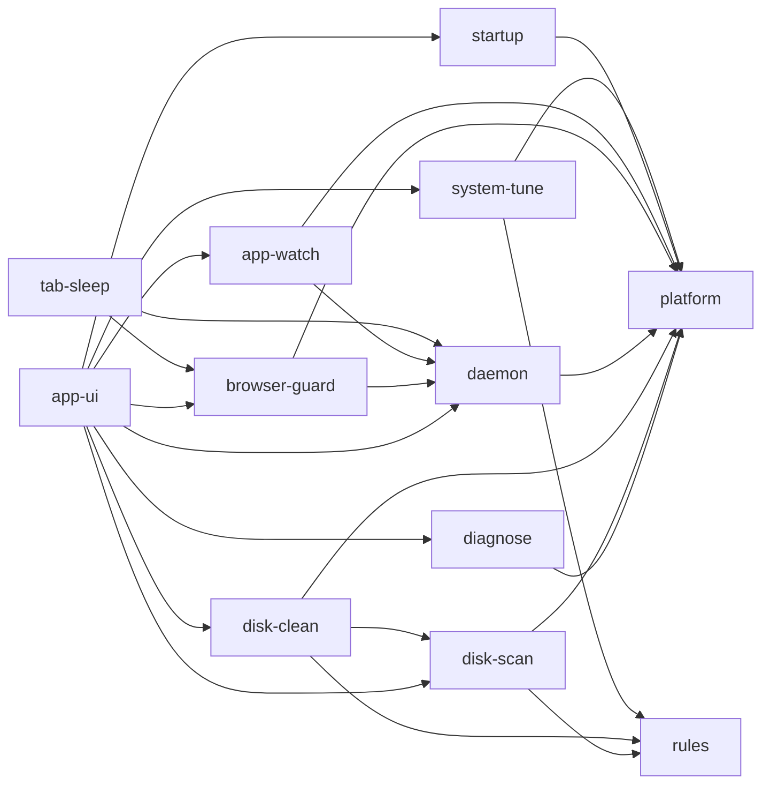

# Design 0002 : système (modules, processus, contrat avec l'interface)

- **Statut** : à relire (étape 2.5 du parcours)
- **Date** : 2026-10-18
- **Sources** : `docs/PRD.md` (§5, §7, §10, §11), ADR 0001 à 0007, `docs/design/0001-machines-a-etats.md`, `AGENTS.md`
- **Vocabulaire** : `GLOSSARY.md` fait foi.

Ce document décide *où vit chaque règle* et *par où on l'appelle*. Il ne décrit ni les fichiers de données (ADR 0003) ni le code. Les parties du modèle de design du kit qui supposent un serveur (cloisonnement par périmètre, lecture d'une donnée très sensible, vue publique, groupes de routes) sont **sans objet** pour Breathly : un seul utilisateur, une seule machine, aucune donnée qui sort (PRD §0 point 4).

## 1. Principes de conception

1. **Une règle, un seul endroit.** Chaque garde-fou (S5) est écrit et testé une fois, dans `breathly-disk`, et revérifié pour chaque élément (design 0001, invariant 3).
2. **Interfaces étroites.** Un crate expose quelques fonctions publiques ; le reste est `pub(crate)`.
3. **Un trait seulement s'il varie.** Les traits de `platform` existent parce que l'OS varie, et pour avoir un faux dans les tests.
4. **Les modules se parlent par fonctions publiques**, jamais par les éléments internes d'un autre.
5. **L'interface n'a aucune règle métier** : elle affiche et déclenche (ADR 0001, `AGENTS.md`).
6. **Rien ne tourne quand ce n'est pas nécessaire** (G5) : en V0.1, aucun processus fenêtre fermée.

## 2. Carte des modules

| Module | Crate | Possède | Fonctions publiques principales | Version |
|---|---|---|---|---|
| `platform` | `breathly-platform` | mesures système, chemins standard, corbeille, traits par OS | `ProcessInspector`, `DiskInspector`, `TemperatureReader`, `TrashProvider`, `Clock` ; V0.2 `WindowInspector` ; V0.4 `StartupManager` | V0.1 |
| `rules` | `breathly-rules` | règles de nettoyage et de réglage (TOML intégrées), validation | `load_cleanup_rules()`, `load_tuning_rules()` | V0.1 |
| `diagnose` | `breathly-diagnose` | constats typés : disque, RAM, swap, CPU, chauffe, gros consommateurs, processus à examiner | `run_diagnostic(task)` | V0.1 |
| `disk-scan` | `breathly-disk` | analyse du disque, classement par niveau de risque, gros fichiers, dossiers de projet | `analyse_disk(task)` | V0.1 |
| `disk-clean` | `breathly-disk` | simulation, nettoyage, garde-fous, historique, annulation, vidage | `simulate(selection)`, `clean(selection, token)`, `restore(entry)`, `purge_trash(items, token)` | V0.1 |
| `daemon` | `breathly-daemon` | service Breathly, IPC (ADR 0007) | boucle de surveillance, serveur de socket | V0.2 |
| `browser-guard` | `breathly-guard` | détection des navigateurs, RAM par navigateur | `watch_browsers()` | V0.2 |
| `app-watch` | `breathly-watch` | logiciels gourmands inutilisés, alerte d'espace faible | `watch_software()` | V0.2 |
| `tab-sleep` | `breathly-nmhost` + `extension/` | hôte de messagerie native, relais | relais JSON | V0.3 |
| `startup` | `breathly-startup` | logiciels et services système au démarrage | `list_startup()`, `set_startup(entry, on)` | V0.4 |
| `system-tune` | `breathly-tune` | réglages système guidés puis appliqués | `plan_tuning()`, `apply(plan)` via l'assistant | V0.4 |
| `app-ui` | `apps/desktop` | écrans, orchestrateur des recommandations, commandes Tauri | commandes du §6 | V0.1 |
| (assistant) | `breathly-elevated` | actions administrateur à liste fermée (ADR 0006) | un identifiant de règle en entrée | V0.4 |

Le PRD §11 regroupe `disk-scan` et `disk-clean` dans `breathly-disk` : ce sont deux modules Rust dans un crate, `disk-clean` appelle `disk-scan`. Les crates `breathly-watch`, `breathly-startup` et `breathly-tune` s'ajoutent à la liste du PRD §11.

## 3. Dépendances autorisées

Une flèche signifie « appelle une fonction publique de ». Elle est celle du PRD §5 sans écart. **Le graphe d'appels est sans cycle, celui des messages aussi, et leur union aussi.** Les messages sont ceux de l'ADR 0007 (extension vers service). Le service Breathly **n'appelle ni ne notifie jamais `app-ui`** : il notifie l'OS, et un clic sur la notification lance l'interface. Aucun message ne remonte donc contre un appel.

Le prototype jetable `docs/design/prototypes/graphe.py` le vérifie : les trois graphes sont sans cycle, et le graphe du design est conforme au tableau du PRD §5 (11 modules). Une dépendance `platform -> diagnose` introduite exprès est détectée.

## 4. Processus et qui écrit quoi

| Processus | Quand | Écrit | Ne fait jamais |
|---|---|---|---|
| **Interface** (Tauri, embarque les crates du cœur) | fenêtre ouverte | historique, réglages, suppressions, restaurations, vidage | tourner fenêtre fermée |
| **Service Breathly** | V0.2, en permanence | rien sur le disque de l'utilisateur ; lit les réglages | supprimer, écrire l'historique, appeler l'interface |
| **Hôte de messagerie native** | V0.3, lancé par le navigateur | rien | agir sans le service |
| **Assistant `breathly-elevated`** | V0.4, une action | l'action de la règle, rien d'autre | accepter une commande libre |

Décision du 2026-10-18 : diagnostic, analyse et nettoyage s'exécutent **dans le processus de l'interface**. L'interface est l'**unique écrivain** de l'historique : pas de verrou entre processus, et la preuve « rien hors règle touché » vient d'un seul endroit.

## 5. Traits de `platform`

| Trait | Rôle | Faux pour les tests |
|---|---|---|
| `ProcessInspector` | processus, RAM, CPU, chemin de l'exécutable, regroupement par logiciel | liste fixe |
| `DiskInspector` | volumes, espace libre et total | valeurs fixes |
| `TemperatureReader` | température du processeur, « non disponible » sinon | absente ou valeur |
| `TrashProvider` | envoyer, lister, restaurer, purger (crate `trash`, ADR 0005) | corbeille en mémoire |
| `Clock` | l'heure, pour la rotation à 12 mois et les relevés | heure fixe |

**Les tests ne touchent jamais à la vraie corbeille ni au vrai dossier personnel** (PRD §14) : ils travaillent dans un dossier temporaire avec le faux `TrashProvider`. Aucun `cfg(target_os)` hors de ce crate.

## 6. Contrat entre l'interface Svelte et le cœur

Le cœur est exposé à l'interface par des **commandes Tauri** enregistrées une à une. Par défaut Tauri laisse toute commande enregistrée appelable depuis toute fenêtre (ADR 0002) : chaque commande est donc listée dans les capacités et restreinte à la fenêtre principale.

| Commande | Entrée | Sortie | Règle |
|---|---|---|---|
| `start_diagnostic` | — | identifiant de tâche | refusée si un diagnostic tourne (US-001.4) |
| `start_disk_analysis` | — | identifiant de tâche | idem, par type |
| `cancel_task` | identifiant de tâche | — | arrêt coopératif, aucun fichier modifié |
| `get_recommendations` | — | recommandations (au plus 5) | orchestrateur, voir §7 |
| `simulate_cleanup` | identifiants d'éléments | rapport + jeton de confirmation | ne modifie rien (US-032) |
| `start_cleanup` | jeton de confirmation | identifiant de tâche | exige la simulation et la confirmation (design 0001) |
| `stop_cleanup` | identifiant de tâche | — | arrêt après l'élément en cours (US-036.3) |
| `list_history`, `restore_entry`, `erase_unrecoverable_entries` | filtres, identifiant | entrées, résultat | vérifie l'état « non annulable » à la demande (US-040.7) |
| `purge_trash` | éléments listés, jeton | résultat | confirmation avec nombre et taille (US-037) |
| `get_settings`, `set_settings` | réglages typés | réglages | valide les seuils et les chemins d'exclusion |
| `open_folder` | identifiant de gros fichier | — | n'ouvre que des dossiers issus de la dernière analyse (US-022.2) |

**Invariant de sécurité : l'interface n'envoie jamais un chemin à supprimer.** Elle envoie des identifiants d'éléments produits par la dernière analyse ; le cœur les résout en chemins via les règles et revérifie les garde-fous. Une interface compromise ne peut donc pas demander de supprimer un chemin arbitraire.

- **Erreurs** : un seul type d'erreur côté cœur avec un code stable, une clé de traduction et des paramètres (jamais de texte de l'utilisateur affiché en dur, US-002.3).
- **Progression** : des événements envoyés à l'interface (identifiant de tâche, avancement croissant) ; les noms exacts de l'API Tauri (événements ou canaux) sont **non vérifiés** et se fixent à l'implémentation.
- **Types partagés** : générés depuis les types Rust vers TypeScript, jamais écrits à la main ; la CI vérifie qu'ils sont à jour (décision du 2026-10-18). Crate de génération à choisir et vérifier à l'implémentation (PRD §14 : ajout de dépendance à demander).

## 7. Composition des recommandations

`diagnose` ne dépend que de `platform` et dure moins de 10 s (D1). Il renvoie des **constats typés** (disque presque plein, swap saturé, chauffe sans charge, gros consommateur, processus à examiner). L'**orchestrateur de `app-ui`** les combine avec la dernière analyse du disque pour chiffrer le gain, trie par gravité puis gain (US-012.3) et garde cinq recommandations au plus. Sans analyse du disque, la recommandation dit « Analysez le disque » sans chiffre. Décision du 2026-10-18 ; aucune dépendance nouvelle entre crates.

## 8. Légèreté par conception (G5)

- V0.1 : aucun processus fenêtre fermée, aucune activité d'arrière-plan.
- Mesures **échantillonnées**, pas continues ; un seul fil de surveillance dans le service (V0.2).
- L'analyse du disque agrège par règle et ne garde en mémoire que les totaux et les N plus gros éléments, pas les 500 000 chemins ; nombre de fils borné. **Hypothèse non vérifiée**, à mesurer par le prototype (ADR 0008).

## 9. Décisions et points ouverts

| # | Sujet | État |
|---|---|---|
| 1 | Exécution dans le processus de l'interface | décidé le 2026-10-18 |
| 2 | Recommandations composées par l'orchestrateur | décidé le 2026-10-18 |
| 3 | Types TypeScript générés depuis Rust | décidé ; crate à choisir à l'implémentation |
| 4 | Environnement asynchrone (fils standard ou bibliothèque asynchrone) | ouvert : ADR à écrire avec le premier prototype ; dépendance à demander (PRD §14) |
| 5 | Noms exacts de l'API Tauri pour la progression | ouvert, non vérifié |
| 6 | Mémoire et fils de l'analyse du disque | ouvert, mesuré par le prototype (ADR 0008) |
| 8 | `sysinfo` renvoie les fils d'exécution comme des processus sous Linux : les écarter (`thread_kind`) et regrouper par nom d'exécutable, sinon la mémoire est comptée plusieurs fois (prototype P2) | établi le 2026-10-18 ; RSS cumulé d'un navigateur à relire (mémoire partagée) |
| 7 | Chemins Windows très longs et jonctions dans les garde-fous | ouvert : tests dédiés (US-034.3) |
