# Parcours de Breathly : du dépôt à la première ligne de code

Schéma des étapes exigées par l'[Agentic Kit SINDA SARL](https://github.com/SINDASARL/agentic-kit-sinda-sarl) (version 1.2.0), adapté au profil de Breathly : **outil local, sans serveur ni base de données, dépôt public**. Le détail de chaque étape (livrable, preuve) est dans `ADOPTION.md` du kit. **Ce fichier se met à jour à chaque étape terminée** (PR dédiée ou même PR que l'étape).

Principe : on ne brûle aucune étape. La porte « on peut coder » (étape 7) n'est franchie que cases cochées.

## Qui fait quoi

| Rôle | Pour Breathly |
|---|---|
| **Propriétaire** | AresGn : décide, valide le PRD et les ADR, active la protection de `main` |
| **Développeur** | une personne par application : cœur Rust, interface Svelte, extension |
| **Agent IA** | rédige les brouillons, vérifie dans la documentation officielle, relit ; ne décide pas |
| **Client** | sans objet (projet libre, pas de client) |
| **Relecteur** | une seconde personne quand elle existe ; sinon relecture différée du propriétaire |

## Schéma et état au 2026-10-18

Vert : fait. Orange : en cours. Gris : à faire. Hachuré : sans objet pour Breathly.

```mermaid
flowchart TD
    A0["0 · Prérequis<br/>Propriétaire"] --> A1["1 · Initialiser le dépôt<br/>Propriétaire + Agent"]
    A1 --> B

    subgraph B["2 · Cadrer le produit (ne rien coder)"]
        direction TB
        B1["2.1 Glossaire<br/>Agent rédige · Propriétaire valide"] --> B2["2.2 PRD<br/>Propriétaire décide<br/>stories numérotées, critères testables"]
        B2 --> B3["2.3 ADR de départ<br/>Propriétaire décide · Agent documente"]
        B3 --> B4["2.4 Machines à états<br/>si l'outil a des états métier"]
        B4 --> B5["2.5 Design du système<br/>modules, protocole extension - hôte - daemon"]
        B5 --> B6["2.6 Design de la base<br/>sans objet"]
        B6 --> B7["2.7 Écrans et maquettes<br/>4 écrans"]
        B7 --> B8["2.8 Sécurité<br/>modèle de menaces :<br/>suppression, droits admin, réseau"]
        B8 --> B9["2.9 Prototype technique<br/>Tauri + Svelte, native messaging,<br/>corbeille"]
    end

    B --> C["3 · Règles du projet<br/>Propriétaire"]
    C --> D["4 · Vérifier les outils<br/>Développeur + Agent<br/>pack rust, sondes négatives"]
    D --> E["5 · Initialiser les applications<br/>cœur Rust · interface · extension"]
    E --> F["6 · Backlog par vagues<br/>Propriétaire + Agent"]
    F --> G{{"7 · Porte on peut coder<br/>Propriétaire"}}
    G -- non --> B
    G -- oui --> H["Première PR de fonctionnalité<br/>Développeur"]
    H --> I["8 · Rituels<br/>Tous"]

    classDef done fill:#d4edda,stroke:#2e7d32,color:#111
    classDef progress fill:#fff3cd,stroke:#b8860b,color:#111
    classDef todo fill:#eceff1,stroke:#607d8b,color:#111
    classDef na fill:#fafafa,stroke:#bbb,stroke-dasharray: 4 3,color:#888
    class A0,A1,B1,B2,B3,B4,B5,B7,B8,B9,C,D,E done
    class F done
    class G progress
    class H,I todo
    class B6 na
```

## Détail de l'état

Protection de `main` : appliquée le 2026-10-18 (voir `CONTRIBUTING.md` §5).

| Étape | État | Reste à faire |
|---|---|---|
| 0 · Prérequis | fait | |
| 1 · Initialiser | fait (PR #1) | |
| 2.1 Glossaire | fait (PR de cette étape) | `GLOSSARY.md` : 7 ambiguïtés levées ; à compléter à chaque terme nouveau, dans la PR du code qui l'introduit |
| 2.2 PRD | fait (PR #8) | `docs/stories.md` : V0.1 détaillée (US-001 à US-073), V0.2 à V1.0 numérotées ; critères détaillés de V0.2+ après les prototypes |
| 2.3 ADR | fait, 1 en attente | ADR 0001 à 0008 et 0010, 0011 écrits (0006 et 0007 « proposé », à confirmer par prototype) ; **ADR 0008 (budgets) accepté le 2026-10-18** ; **ADR 0009 (« inutilisé ») en attente** : il se décide avec les essais Wayland et Windows |
| 2.4 États | fait | `docs/design/0001-machines-a-etats.md` : analyse, nettoyage, entrée d'historique ; prototype jetable `etats.py` (sondes négatives détectées) ; machines V0.2+ à écrire avant leur version |
| 2.5 Design du système | fait | `docs/design/0002-systeme.md` : carte des modules, dépendances sans cycle (prototype `graphe.py`, conforme au PRD §5), processus et qui écrit quoi, contrat Tauri, composition des recommandations ; 4 points ouverts (asynchrone, API de progression, mémoire de l'analyse, chemins Windows) |
| 2.6 Base | sans objet | pas de base de données ; le format des fichiers locaux relève d'un ADR (2.3) |
| 2.7 Maquettes | fait (écarts à traiter) | 20 écrans livrés le 2026-10-18 dans `docs/design/maquettes/` (clair et sombre, jetons `breathly.css`) ; reste : libellés anglais appliqués, logo à vectoriser, texte à 200 %, polices à embarquer en WOFF2 |
| 2.8 Sécurité | fait | `docs/policies/modele-de-menaces.md` (5 flux, 16 tests de sécurité TS-01 à TS-16) ; `securite.md` réécrit pour un outil local (SEC1 à SEC11) ; points ouverts : suppression sûre, CSP Tauri, attestation de provenance |
| 2.9 Prototype | fait sous Linux | P1, P2, P3, P5 (`docs/research/2026-10-18-prototypes-2-9.md`), P4 et P6 (`docs/research/2026-10-18-coquille-desktop.md`). **Reste, hors porte** : Windows, Wayland, Zen/Brave/snap/Flatpak en exécution ; ADR 0009 |
| 3 · Règles | fait (prouvé à l'étape 4) | structure (ADR 0010), outillage (ADR 0011) ; `CODING.md` Rust et `CODING.md` de l'interface réécrits pour Breathly ; `AGENTS.md` rempli ; reste `make kit-todo` (guide de démarrage, modèle de menaces, README de l'interface) |
| 4 · Outils | fait (PR de cette étape) | outils éprouvés le 2026-10-18 par sondes négatives, au niveau de chaque outil puis de `make check` (`docs/research/2026-10-18-outils-etape-4.md`) ; ajoutés : `cargo-deny` (`deny.toml`), `clippy.toml`, `tools/check-rust.py`, lints complétés dans `Cargo.lints.fragment.toml` ; CI corrigée (Rust lu dans `rust-toolchain.toml`, outils installés, lockfile pnpm à la racine, Node 24, `actions/cache` épinglée). **Reste, à l'étape 5** : créer les fichiers réels à partir de `docs/research/outils-etape-4/interface/` ; vérifier la CI sur un exécuteur hébergé |
| 5 · Applications | fait | workspace Cargo + 4 crates vides (PR #20) ; coquille `apps/desktop` (Tauri + SvelteKit SPA, CSP stricte, `make check` vert, CI hébergée verte) ; budgets décidés (ADR 0008) : fenêtre ≤ 350 Mo de PSS, pas d'AppImage en V0.1 ; identifiant `io.github.aresgn.breathly` |
| 6 · Backlog | fait | 112 tickets publiés le 2026-10-18 (#24 à #135) en 5 milestones M0 à M4, avec liens de blocage natifs (vérifiés ticket par ticket) ; 11 décisions et 5 validations sur machines vous sont assignées ; vue globale dans `docs/backlog.md`. **Reste** : la porte 7, dont les 11 décisions qui bloquent M0 |
| 7 · Porte | non franchie | |
| 8 · Rituels | dès la première PR de fonctionnalité | |

## Étapes sans objet pour Breathly, et pourquoi

- **2.6 Design de la base** : aucune base serveur ; aucune donnée ne quitte la machine (PRD §0 point 4).
- **Client et validation contractuelle** : projet libre.
- Les règles de sécurité qui visent une API (routes authentifiées, limitation de débit, cloisonnement) ont été remplacées par SEC1 à SEC11, écrites pour un outil local (étape 2.8).
