# Parcours de Breathly : du dépôt à la première ligne de code

Schéma des étapes exigées par l'[Agentic Kit SINDA SARL](https://github.com/SINDASARL/agentic-kit-sinda-sarl) (version 1.2.0), adapté au profil de Breathly : **outil local, sans serveur ni base de données, dépôt public**. Le détail de chaque étape (livrable, preuve) est dans `ADOPTION.md` du kit. **Ce fichier se met à jour à chaque étape terminée** (PR dédiée ou même PR que l'étape).

Principe : on ne brûle aucune étape. La porte « on peut coder » (étape 7) n'est franchie que cases cochées.

## Qui fait quoi

| Rôle | Pour Breathly |
|---|---|
| **Propriétaire** | AresGn : décide, valide le PRD et les ADR, active la protection de `main` |
| **Développeur** | une personne par application : cœur Rust, interface Svelte, extension |
| **Agent IA** | rédige les brouillons, vérifie dans la documentation officielle, relit ; ne décide pas |
| **Client** | sans objet (projet libre, pas de client) |
| **Relecteur** | une seconde personne quand elle existe ; sinon relecture différée du propriétaire |

## Schéma et état au 2026-10-18

Vert : fait. Orange : en cours. Gris : à faire. Hachuré : sans objet pour Breathly.

```mermaid
flowchart TD
    A0["0 · Prérequis<br/>Propriétaire"] --> A1["1 · Initialiser le dépôt<br/>Propriétaire + Agent"]
    A1 --> B

    subgraph B["2 · Cadrer le produit (ne rien coder)"]
        direction TB
        B1["2.1 Glossaire<br/>Agent rédige · Propriétaire valide"] --> B2["2.2 PRD<br/>Propriétaire décide<br/>stories numérotées, critères testables"]
        B2 --> B3["2.3 ADR de départ<br/>Propriétaire décide · Agent documente"]
        B3 --> B4["2.4 Machines à états<br/>si l'outil a des états métier"]
        B4 --> B5["2.5 Design du système<br/>modules, protocole extension - hôte - daemon"]
        B5 --> B6["2.6 Design de la base<br/>sans objet"]
        B6 --> B7["2.7 Écrans et maquettes<br/>4 écrans"]
        B7 --> B8["2.8 Sécurité<br/>modèle de menaces :<br/>suppression, droits admin, réseau"]
        B8 --> B9["2.9 Prototype technique<br/>Tauri + Svelte, native messaging,<br/>corbeille"]
    end

    B --> C["3 · Règles du projet<br/>Propriétaire"]
    C --> D["4 · Vérifier les outils<br/>Développeur + Agent<br/>pack rust, sondes négatives"]
    D --> E["5 · Initialiser les applications<br/>cœur Rust · interface · extension"]
    E --> F["6 · Backlog par vagues<br/>Propriétaire + Agent"]
    F --> G{{"7 · Porte on peut coder<br/>Propriétaire"}}
    G -- non --> B
    G -- oui --> H["Première PR de fonctionnalité<br/>Développeur"]
    H --> I["8 · Rituels<br/>Tous"]

    classDef done fill:#d4edda,stroke:#2e7d32,color:#111
    classDef progress fill:#fff3cd,stroke:#b8860b,color:#111
    classDef todo fill:#eceff1,stroke:#607d8b,color:#111
    classDef na fill:#fafafa,stroke:#bbb,stroke-dasharray: 4 3,color:#888
    class A0,A1 done
    class B2,B3,C progress
    class B1,B4,B5,B7,B8,B9,D,E,F,G,H,I todo
    class B6 na
```

## Détail de l'état

| Étape | État | Reste à faire |
|---|---|---|
| 0 · Prérequis | fait | |
| 1 · Initialiser | fait (PR #1) | |
| 2.1 Glossaire | à faire | termes du PRD : niveau de risque, règle, garde-fou, onglet du quotidien, hôte, daemon… |
| 2.2 PRD | en cours | cadrage validé (PR #3) ; **stories numérotées et critères d'acceptation** à écrire ; risques ouverts à relire |
| 2.3 ADR | en cours | ADR 0001 (Svelte 5) accepté sous réserve du prototype ; à écrire : format de l'historique et des réglages, protocole extension - hôte - daemon, élévation des droits administrateur |
| 2.4 États | à décider | peut-être : analyse, nettoyage, annulation |
| 2.5 Design du système | à faire | modules sans cycle (PRD §5), protocole entre processus |
| 2.6 Base | sans objet | pas de base de données ; le format des fichiers locaux relève d'un ADR (2.3) |
| 2.7 Maquettes | à faire | accueil, diagnostic, disque, onglets, dans `docs/design/` |
| 2.8 Sécurité | à faire | `docs/policies/modele-de-menaces.md` ; adapter `securite.md` (règles écrites pour une API) |
| 2.9 Prototype | à faire | Tauri v2 + Svelte 5 ; native messaging (Firefox, Chromium, flatpak/snap) ; suppression vers la corbeille sur Linux et Windows |
| 3 · Règles | en cours | `AGENTS.md` rempli ; `make kit-todo` renvoie encore des lignes (SECURITY.md, CODE_OF_CONDUCT.md, guide de démarrage, menaces) ; protection de `main` non appliquée |
| 4 · Outils | à faire | pack `rust` non éprouvé : exécuter chaque commande sur un workspace vide, sondes négatives, `pin-actions.py` |
| 5 · Applications | à faire | `Cargo.toml` racine, `extension/package.json`, `apps/desktop/ui` |
| 6 · Backlog | à faire | après la porte des étapes 2 à 5 |
| 7 · Porte | non franchie | |
| 8 · Rituels | dès la première PR de fonctionnalité | |

## Étapes sans objet pour Breathly, et pourquoi

- **2.6 Design de la base** : aucune base serveur ; aucune donnée ne quitte la machine (PRD §0 point 4).
- **Client et validation contractuelle** : projet libre.
- Les règles de `securite.md` qui visent une API (routes authentifiées, limitation de débit…) sont à réécrire pour un outil local : c'est l'objet de l'étape 2.8.
